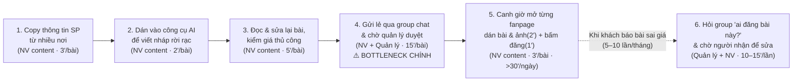
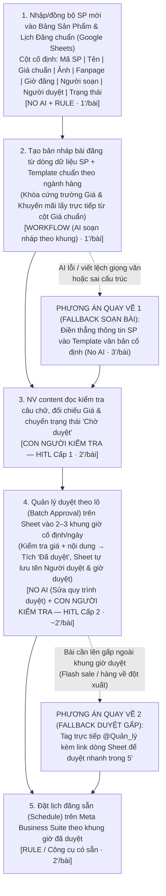

# Báo cáo nhóm — Day 02 Discovery & Problem Framing

> Bản chung của nhóm, viết trên repo do nhóm trưởng fork. Không copy file này sang repo cá nhân.
> Template chi tiết và prompt mẫu: [docs/01-worksheet.md](../../docs/01-worksheet.md). Bài mẫu: [docs/02-deliverable-example.md](../../docs/02-deliverable-example.md).

## 1. Thông tin nhóm

- Tên nhóm:
- Thành viên: xem `TEAM.md`
- Candidate problem được chọn (1 câu): Nhân viên content của shop bán lẻ nhỏ phải gửi lẻ từng bài vào nhóm Zalo chờ chủ shop duyệt (15 phút đến 3,5 tiếng/bài) và lấy giá từ nhiều nguồn không đồng bộ, khiến 3–5 bài/tuần lỡ khung giờ đăng và 1–2 bài/tháng sai giá phải bù tiền cho khách.
- Quyết định cuối: **Go, phạm vi nhỏ** (mức Rule kèm sửa quy trình duyệt; pilot 2 tuần, 1 fanpage, không có AI trong pilot)

---

## 2. Hội tụ nhóm (CP3)

### 2.1. Pitch

| # | Người đưa ra | Candidate (Job Story ngắn) | Actor | Bottleneck | Câu hỏi phản biện nhận được (ai hỏi) |
|---:|---|---|---|---|---|
| 1 | Nguyễn Thế Văn | Khi mỗi ngày có hơn 50 sản phẩm mới cần đăng lên các fanpage, tôi muốn biến thông tin sản phẩm thành bài đăng mà không copy qua lại nhiều nơi, để kịp lịch đăng | Nhân viên content fanpage; quản lý duyệt | Chờ quản lý duyệt: 15'/bài (thao tác tay 13'/bài); 4–5 bài/tuần đăng trễ | Bài gửi duyệt bị trả về sửa bao nhiêu % — nghẽn thật là chờ duyệt 15', hay là bước soạn trước đó làm bài phải duyệt lại? (Lê Anh Sơn) |
| 2 | Nguyễn Thế Văn | Khi một bài trên fanpage bị sai giá, tôi muốn biết ai đã đăng và ai đã duyệt, để sửa nhanh và nhắc đúng người | Quản lý fanpage | Hỏi group "ai đăng" và chờ người nhận: 10–15'/lần, 5–10 lần/tháng | Lần gần nhất bài sai giá là khi nào, từ lúc phát hiện đến lúc sửa xong mất bao lâu? (Hoàng Nguyên Long) |
| 3 | Nguyễn Thế Văn | Khi có nhiều bài cần lên trong tuần, tôi muốn thấy bài nào đăng giờ nào trên trang nào, để không trùng hoặc trống lịch | Nhân viên content quản lý hơn 10 trang | Đến giờ vào từng trang đăng tay: >30'/ngày; 10 lần trùng/trống tuần trước | Không có AI, chỉ dùng lên lịch có sẵn của Meta Business Suite thì cắt được bao nhiêu trong >30'/ngày? (Lưu Đăng Tuấn) |
| 4 | Lê Anh Sơn | Khi hoàn thành bài lab trước giờ nộp, tôi muốn đối soát nhanh quy cách file và checklist rubric, để không bị trừ điểm vì lỗi định dạng | Học viên làm lab | Kiểm thủ công từng cell notebook và đề mục markdown: 18/30' | Ngoài bạn còn ai gặp? Số 7/35 bạn bị nhắc lỗi định dạng ở Day 01 lấy từ đâu, có tin nhắn TA hay bảng điểm không? (Nguyễn Thế Văn) |
| 5 | Lê Anh Sơn | Khi bắt đầu buổi lab với 4–5 file hướng dẫn dài, tôi muốn nắm ngay danh sách đầu việc cá nhân và nhóm, để phân bổ 4 tiếng hợp lý | Nhóm trưởng, học viên | Chuyển qua lại giữa các tab tài liệu để ghép checkpoint → file → mục → tiêu chí: 20/35' | Không có AI, một cheat sheet 1 trang do nhóm trưởng làm trong 10' có giảm được nửa 20' không? (Lưu Đăng Tuấn) |
| 6 | Lê Anh Sơn | Khi gọi API của nhà cung cấp LLM với tham số mới, tôi muốn tìm đúng tên tham số hiện hành, để code chạy ngay không bị lỗi 400 | Học viên làm lab tích hợp LLM | Tra tài liệu bị phân mảnh giữa phiên bản cũ và mới: 12/30' | Lần gần nhất bị lỗi 400 vì sai tên tham số là khi nào, mất bao lâu mới chạy được? (Hoàng Nguyên Long) |
| 7 | Lưu Đăng Tuấn | Khi kỳ thi tới gần và phải ôn từ slide, ghi chú, đề cũ, group chat, tôi muốn biết phần nào là trọng tâm, để không ôn tràn lan và không bỏ sót | Sinh viên thi 2–3 môn cùng lúc | Tự tổng hợp nhiều nguồn và suy đoán mức quan trọng từng chủ đề (chưa có số phút) | Lần ôn thi gần nhất là môn nào, bạn mất bao nhiêu phút để tổng hợp nguồn và chốt trọng tâm? (Hoàng Nguyên Long) |
| 8 | Lưu Đăng Tuấn | Khi luyện đề cũ, tôi muốn biết dạng câu hỏi nào hay xuất hiện, để luyện đúng dạng | Sinh viên ôn thi | Đọc và tự phân loại câu hỏi đề cũ theo chương/dạng (chưa có số phút) | Ngoài bạn còn ai luyện đề bằng cách so nhiều đề để tìm dạng lặp, hay mọi người chỉ làm lần lượt từng đề? Có bằng chứng không? (Nguyễn Thế Văn) |
| 9 | Lưu Đăng Tuấn | Khi cần xem lại một câu hỏi và lời giải đã được trả lời trong group chat, tôi muốn tìm lại nhanh và biết nó có đúng không, để không hỏi lại | Sinh viên trong group lớp | Lời giải rải rác trong luồng chat, từ khóa không khớp (chưa có số phút) | Bottleneck là tìm lại tin, hay là bước sau nó — tìm thấy rồi vẫn không biết lời giải có đúng không nên phải hỏi lại? (Lê Anh Sơn) |
| 10 | Hoàng Nguyên Long | Khi mở inbox Zalo OA/fanpage đầu ca, lễ tân muốn tách ngay tin theo loại, để tin triệu chứng được chuyển điều dưỡng sớm | Lễ tân phòng khám nhi (2 người/ca); điều dưỡng trực | Đọc tuần tự 40–60 tin để biết tin nào loại gì: ~25' trong ~45' đầu ca | Bottleneck thật là đọc 25', hay là bước trước — phụ huynh không có lựa chọn phân loại khi nhắn? Bao nhiêu % tin là triệu chứng? (Nguyễn Thế Văn) |
| 11 | Hoàng Nguyên Long | Khi phụ huynh gọi hỏi bé tiêm mũi gì tiếp theo, nhân viên muốn tra đúng mũi theo tuổi và lịch sử tiêm, để trả lời trong 1–2' | Nhân viên tư vấn hotline tiêm chủng | Tìm lịch sử tiêm và đối chiếu bảng lịch theo tuổi: ~6' trong ~10'/cuộc gọi | Ngoài chị bạn còn ai gặp? Số 6'/cuộc gọi là bạn quan sát hay ước đoán từ phía người gọi? (Lê Anh Sơn) |
| 12 | Hoàng Nguyên Long | Khi chuẩn bị đưa bố đi tái khám tiểu đường, tôi muốn có bảng chỉ số 6 tháng theo thời gian, để bác sĩ thấy xu hướng ngay | Người nhà chăm người bệnh mạn tính | Đọc từng tờ kết quả khác mẫu, chép chỉ số và đổi đơn vị: ~15' trong ~40'/lần | Không có AI, mỗi lần nhận kết quả thì điền ngay 1 dòng Google Sheet (~2') có giảm được nửa 40'/tháng không? (Lưu Đăng Tuấn) |

#### Hỏi đáp khi pitch

*Nháp đóng vai do AI soạn từ 4 báo cáo cá nhân. Mỗi người tự sửa câu trả lời của mình cho đúng thực tế; chỗ ghi "chưa đo" đưa vào Assumption Map ở CP4.*

| Card | Người hỏi → người trả lời | Câu trả lời | Hệ quả cho nhóm |
|---:|---|---|---|
| #1 | Sơn → Văn | Chưa đếm tỉ lệ bài bị trả về. Số đã có: chờ duyệt 15'/bài, thao tác tay 13'/bài, 4–5 bài/tuần đăng trễ. Nếu bài bị trả về nhiều thì nghẽn nằm ở bước soạn | Giả định "nghẽn ở chờ duyệt, không phải soạn" cần kiểm chứng trước |
| #2 | Long → Văn | Gặp 5–10 lần/tháng, riêng khâu hỏi group "ai đăng" mất 10–15'/lần; thời gian bài sai còn hiển thị với khách chưa đo | Đo thêm thời gian từ lúc phát hiện đến lúc sửa xong |
| #3 | Tuấn → Văn | Lên lịch có sẵn bỏ được bước canh giờ vào từng trang (3'/bài); team chưa dùng vì chưa có lịch chung. Chưa thử nên chưa có số | Phương án No AI có thể giải phần lớn #3 |
| #4 | Văn → Sơn | 7/35 là số bạn bị nhắc trong lớp Day 01; cần tìm lại tin nhắn TA để làm bằng chứng | Bằng chứng mới ở mức kể lại |
| #5 | Tuấn → Sơn | Có thể: bước nghẽn là chuyển tab để ghép checkpoint → file → mục → tiêu chí (20/35'). Cheat sheet làm 1 lần dùng được cho cả lớp | #5 nghiêng về No AI |
| #6 | Long → Sơn | Bước tra docs mất 12/30'; chưa ghi ngày và số lần gặp lỗi 400 | Thiếu tần suất, khó chấm "Pain có bằng chứng" |
| #7 | Long → Tuấn | Chưa đo. Quy trình hiện tại mới là giả thuyết | Thiếu số phút, chưa đủ để vào shortlist |
| #8 | Văn → Tuấn | Chưa chắc; đây chính là câu cần kiểm chứng trong card: sinh viên có dùng nhiều đề để tìm dạng lặp hay chỉ làm lần lượt | Pain chưa có bằng chứng |
| #9 | Sơn → Tuấn | Đồng ý: bước nghẽn đã ghi trong card là "kiểm tra câu trả lời và ngữ cảnh", không phải tìm từ khóa. Chưa đo số lần hỏi lại | Bottleneck dời sang bước xác minh |
| #10 | Văn → Long | Lễ tân kể 40–60 tin/sáng, 35–45' đọc và phân loại; tuần trước 1 tin bé sốt cao bị trả lời sau 2 tiếng. Tỉ lệ tin triệu chứng chưa đếm; menu bấm sẵn trên Zalo OA giải được phần lớn nhưng nhiều phụ huynh vẫn gõ tự do | Cần đếm tỉ lệ tin gõ tự do và tin triệu chứng |
| #11 | Sơn → Long | Số liệu từ phía người gọi: chị gọi 3 lần/năm, mỗi lần chờ máy 5–10'. 6'/cuộc gọi là ước đoán, chưa quan sát nhân viên | Nhóm không có ai trong domain; lịch tiêm là Rule nên ít chỗ so sánh 4 mức |
| #12 | Tuấn → Long | Có thể: bước nghẽn là chép chỉ số từ các mẫu khác nhau (~15'); điền ngay mỗi lần thì tối trước khám chỉ còn mở sheet. Tần suất thấp: 1 lần/tháng | Impact nhỏ, No AI đủ dùng |

### 2.2. Cluster

| Cluster | Các candidate | Pattern chung |
|---|---|---|
| A — Tổng hợp nhiều nguồn để biết cái gì quan trọng | #5, #7, #8, #12 | Thông tin nằm ở nhiều tài liệu khác mẫu; người dùng phải tự đọc, gom và suy ra phần quan trọng |
| B — Phân loại và tìm lại tin nhắn | #9, #10 | Tin viết tự do trôi trong luồng chat; khó biết tin nào thuộc loại gì hoặc tìm lại tin cũ |
| C — Đối chiếu với quy tắc hoặc bảng cố định | #2, #4, #6, #11 | Đáp án đã có sẵn ở một bảng, checklist hay log; chậm vì tra cứu tay, không vì cần suy luận |
| D — Sản xuất và phát hành nội dung lặp lại | #1, #3 | Khối lượng bài lớn mỗi ngày; nghẽn ở khâu duyệt và đăng tay trên nhiều trang |

*Nháp do AI gom từ 4 file cá nhân. Nhóm thảo luận và sửa lại khi làm CP3.*

### 2.3. Opportunity Solution Tree rút gọn

Gốc là **1 outcome**. Nhánh là **opportunity** (nhu cầu, pain), không phải tính năng hay công cụ.

```text
OUTCOME: Giảm thời gian từ lúc có sản phẩm mới đến lúc bài đúng thông tin lên fanpage đúng khung giờ, không tăng số bài sai giá
├── Opportunity A: Bài chờ quản lý duyệt ~15'/bài, lâu hơn cả phần thao tác; 4–5 bài/tuần lỡ khung giờ đăng (#1)
├── Opportunity B: Mỗi bài phải copy tay tên, giá, ảnh sản phẩm qua nhiều nơi, ~13'/bài thao tác (#1)
├── Opportunity C: Đến giờ phải vào từng trang trong >10 trang để đăng; tuần trước 10 lần trùng giờ hoặc bỏ trống (#3)
└── Opportunity D: Khi bài sai giá, mất 10–15'/lần hỏi group để biết ai đăng, ai duyệt; 5–10 lần/tháng (#2)
     ✗ "AI tự viết bài từ thông tin sản phẩm"   ← solution, gạch khỏi tầng này
     ✗ "Tool tự đăng lên tất cả các trang"      ← solution, gạch khỏi tầng này
     ✗ "Bot nhắc quản lý duyệt bài"             ← solution, gạch khỏi tầng này
     ✗ "Dashboard theo dõi ai đăng bài nào"     ← solution, gạch khỏi tầng này
```

Những ý đã gạch bỏ vì là solution đội lốt opportunity:

- "Thiếu công cụ AI viết bài": đây là cách giải cho Opportunity B. Câu hỏi của Sơn ở #1 cho thấy nếu nghẽn nằm ở chờ duyệt thì viết nhanh hơn cũng không làm bài lên sớm hơn.
- "Cần tự động đăng lên nhiều trang": là cách giải cho Opportunity C. Pain thật là phải canh giờ và vào từng trang, và Meta Business Suite có thể đã giải được (câu hỏi của Tuấn ở #3).
- "Cần dashboard truy vết bài": là cách giải cho Opportunity D. Pain thật là mất 10–15' để tìm đúng người.

### 2.4. Chấm điểm shortlist (1–5)

Shortlist lấy 1 candidate mạnh nhất từ 3 người có số liệu đo được. Cluster A của Tuấn (#7, #8, #9) không vào shortlist vì chưa có số phút hay tần suất (câu hỏi của Long ở #7, của Văn ở #8).

| Candidate | Actor rõ | Quy trình rõ | Pain có bằng chứng | Impact đo được | Vừa sức lab | So sánh được No AI/Rule/Workflow/Agent | Nhóm hiểu domain | Tổng |
|---|---:|---:|---:|---:|---:|---:|---:|---:|
| #1 Soạn, duyệt, đăng bài sản phẩm lên fanpage (gộp #2, #3) | 5 | 5 | 4 | 5 | 4 | 5 | 4 | **32** |
| #10 Phân loại inbox đầu ca phòng khám nhi | 5 | 5 | 4 | 4 | 3 | 5 | 2 | 28 |
| #4 Đối soát quy cách file với rubric trước giờ nộp lab | 5 | 5 | 3 | 3 | 5 | 2 | 5 | 28 |

Lý do chấm ở các ô thấp:
- #1 "Vừa sức lab" 4: khối lượng lớn (hơn 10 trang), nhưng thu hẹp được về 1 trang và 1 loại sản phẩm. "Pain có bằng chứng" 4: số liệu do Văn tự trải nghiệm, chưa có người ngoài nhóm xác nhận.
- #10 "Vừa sức lab" 3: không truy cập được inbox thật, và dữ liệu tin nhắn có thông tin sức khỏe của trẻ. "Nhóm hiểu domain" 2: chỉ Long biết bối cảnh, qua lời kể của lễ tân.
- #4 "So sánh 4 mức" 2: Sơn và AI phản biện đều kết luận một script Rule là đủ, nên gần như không có gì để so ở mức Workflow hay Agent. "Pain có bằng chứng" 3: con số 7/35 mới là kể lại, chưa có tin nhắn của TA (câu hỏi của Văn).

**Candidate được chọn:** #1. Khi nhân viên content cần đăng hơn 10 bài sản phẩm mỗi ngày lên nhiều fanpage, bài bị chậm vì phải chờ duyệt và đăng tay từng trang, khiến 4–5 bài/tuần lỡ khung giờ đăng.

**Vì sao chọn:** Điểm cao nhất (32). Quy trình đã có số phút cho từng bước. Ba candidate #1, #2, #3 cùng actor và cùng quy trình nên gom được thành 1 bài có 4 opportunity. Bài cũng có đủ phương án ở cả 4 mức để so sánh ở CP6: No AI (khung giờ duyệt cố định, template), Rule (lên lịch, file sản phẩm chuẩn), Workflow (AI soạn nháp, người duyệt), Agent. Chỗ chưa chắc là nghẽn nằm ở khâu soạn hay khâu chờ duyệt; nhóm chuyển câu này thành giả định cần kiểm chứng trước ở CP4.

**Vì sao loại các candidate còn lại:**
- #10: impact tốt, nhưng dữ liệu y tế nhạy cảm, không lấy được inbox thật trong buổi lab, và chỉ 1 người hiểu domain.
- #4: Rule đã đủ dùng, nên không đáp ứng tiêu chí so sánh 4 mức can thiệp.
- #5, #12: phương án không dùng AI (cheat sheet, Google Sheet) đã giải gần hết. #12 lại chỉ xảy ra 1 lần/tháng.
- #6, #11: thiếu tần suất. Con số 6'/cuộc gọi ở #11 là ước đoán từ phía người gọi.
- #7, #8, #9: chưa có số phút, quy trình mới là giả thuyết.

**Xử lý bất đồng (nếu có):** Long muốn chọn #10 vì tin triệu chứng bị trả lời muộn 2 tiếng là rủi ro thật cho trẻ. Nhóm đồng ý #10 có impact lớn nhất về an toàn, nhưng không kiểm chứng được trong buổi lab và có ranh giới y tế cần người trong ngành. Nhóm ghi #10 vào mục 9 "Hướng tiếp theo" và chọn #1 vì có baseline đo được ngay.

---

## 3. Kiểm chứng + research giải pháp đã có (CP4)

### 3.1. Assumption Map

| # | Giả định | Loại (Value / Usability / Feasibility / Viability) | Quan trọng (1–5) | Đã có bằng chứng (1–5) | Kiểm chứng trước? |
|---:|---|---|---:|---:|---|
| 1 | Nhân viên content ở nơi khác cũng mất trên 20 phút/bài cho chuỗi soạn, chờ duyệt và đăng bài (baseline của Văn: 28 phút/bài) | Value | 5 | 4 | Có — **xác nhận** |
| 2 | Bước làm bài lên trễ nhất là chờ duyệt, không phải soạn bài | Value | 5 | 4 | Có — **xác nhận** |
| 3 | Bài sai thông tin xảy ra đủ thường để đáng giải (≥5 lần/tháng) | Value | 4 | 3 | Có — **bác bỏ một phần** |
| 4 | Thông tin sản phẩm đã nằm ở một nguồn có cấu trúc (file, web, phần mềm bán hàng) | Feasibility | 4 | 3 | Có — **một phần** |
| 5 | Quản lý chấp nhận duyệt theo lô ở khung giờ cố định thay vì duyệt từng bài | Viability | 4 | 1 | Hỏi quản lý — **chưa kiểm** |
| 6 | Team chưa dùng lên lịch và lịch sử hoạt động có sẵn của Facebook | Feasibility | 3 | 4 | — **bác bỏ** |

Giả định nhóm kiểm chứng trong buổi này: **#2**, **#1**, **#5**. Đã kiểm được #1, #2 (và thêm #3, #4, #6); #5 chưa kiểm được vì cả 3 người được hỏi đều là nhân viên, không có chủ shop hay quản lý.

Kết quả kiểm chứng từng giả định:

- **#1 — xác nhận:** 3/3 người mất trên 20 phút/bài tính cả chờ duyệt. Thao tác tay 12'/bài (P.) đến 40–45'/bài (L.).
- **#2 — xác nhận:** 3/3 nói chờ duyệt qua Zalo là bước làm bài lên trễ nhất: 15–30' (P.), trung bình 90' (người thứ 2), 30'–3,5 tiếng (L.). Lưu ý: với L., bước *tốn sức* nhất là lựa ảnh và soạn bài (35–40'/bài), nhưng bước *gây trễ* vẫn là chờ duyệt.
- **#3 — bác bỏ một phần:** sai giá chỉ 1–2 lần/tháng ở cả 3 người, thấp hơn mức 5–10 lần/tháng của Văn. Nhưng hậu quả nặng: 2/3 người phải bù tiền chênh lệch cho khách.
- **#4 — một phần:** giá nằm trong file Excel hoặc bảng giá của kho, nhưng giá khuyến mãi cập nhật trong tin nhắn Zalo mà không sửa vào file gốc (P., L.). Đây là nguyên nhân gốc của sai giá.
- **#5 — chưa kiểm:** có một tín hiệu xấu: chủ shop của người thứ 2 không chịu vào Meta Business Suite để duyệt, thử Trello thì bỏ vì "rườm rà".
- **#6 — bác bỏ:** 3/3 người đã dùng Meta Business Suite để lên lịch đăng. Bước "canh giờ vào từng trang đăng tay" chỉ là pain của team Văn.

### 3.2. Kiểm chứng

Cách đã dùng: **Phỏng vấn 3 người ngoài nhóm** theo The Mom Test (bộ câu hỏi ở [cp4-interview-guide.md](../assets/cp4-interview-guide.md)), gọi điện ngày 09/11/2026, 12–14 phút/buổi. Không ai được kể giải pháp trước khi hỏi.

Interview snapshot đầy đủ:

| # | File | Người phỏng vấn | Người được hỏi (vai trò) |
|---:|---|---|---|
| 1 | [cp4-interview-snapshot-ChiP.md](../assets/cp4-interview-snapshot-ChiP.md) | Hoàng Nguyên Long | Nhân viên content chuỗi thời trang/mỹ phẩm, 4 fanpage, 8–12 bài/ngày |
| 2 | [cp4-interview.md](../assets/cp4-interview.md) | Lưu Đăng Tuấn | Nhân viên content kiêm quản lý fanpage thời trang nữ, 2 fanpage, 3–4 bài/ngày |
| 3 | [cp4_interview_snapshot_1.md](../assets/cp4_interview_snapshot_1.md) | Lê Anh Sơn | Nhân viên content shop thời trang nữ, 2 fanpage, 4 bài/ngày |

Snapshot rút gọn — người số 1 (chị P.):

| Trường | Nội dung |
|---|---|
| Người được hỏi (vai trò, không ghi tên thật) | Nhân viên content & vận hành fanpage chuỗi thời trang/mỹ phẩm, 4 fanpage, 1,5 năm kinh nghiệm |
| Câu nói đáng nhớ nhất (nguyên văn) | "Viết nháp 1 bài nhờ ChatGPT thì chỉ mất vài phút thôi em, cái mệt nhất là gửi link sản phẩm với giá vào nhóm Zalo chờ chị chủ duyệt; lúc chị ấy đang bận tiếp khách hay làm việc với kho là bài cứ nằm im đấy nửa tiếng, trôi tuột dưới cả chục tin báo đơn." |
| Lần gần nhất gặp vấn đề này: chuyện gì đã xảy ra? | 08/11/2026: soạn xong 8 bài lúc 10h30 cho khung 11h30, tin xin duyệt trôi giữa các tin đối soát kho, 12h15 mới được duyệt → 3 bài lỡ khung trưa |
| Hiện đang xử lý bằng cách nào (workaround)? | Copy giá từ Excel kho + ảnh từ Zalo → ChatGPT viết nháp → tự sửa → gửi nhóm Zalo, quản lý thả tim để duyệt → lên lịch trên Meta Business Suite |
| Mất bao lâu, bao lần? | Gom giá/ảnh 4' + ChatGPT và sửa 6' + chờ duyệt 15–30' + lên lịch 2' mỗi bài; 3–4 bài/tuần lỡ khung giờ; sai giá 2 lần/tháng |
| Insight / opportunity rút ra | Nghẽn ở chờ duyệt lẻ qua chat và giá nằm rải rác; viết bài và bấm đăng không phải pain |

Tổng hợp:

| Nguồn | Số người / số mẫu | Tín hiệu xác nhận | Tín hiệu phản bác |
|---|---:|---|---|
| Văn tự bấm giờ (trong nhóm) | 1 | 28 phút/bài (13' thao tác + 15' chờ duyệt); 4–5 bài/tuần trễ | — |
| Phỏng vấn người ngoài nhóm | 3 | **3/3** nói chờ duyệt qua Zalo là bước gây trễ nhất (15' đến 3,5 tiếng); **3/3** từng sai giá, 2/3 phải bù tiền cho khách; 2/3 nói sai giá do bảng giá kho không đồng bộ | **3/3** đã dùng Meta Business Suite lên lịch, không đăng tay; sai giá chỉ 1–2 lần/tháng; AI viết bài: **1/3** dùng được (P.), **1/3** đã thử và bỏ vì văn phong chung chung (L.), **1/3** không cần vì có công thức mẫu; **1/3** chủ shop từ chối công cụ mới (Trello, Meta) |

**Nhóm đã sửa problem thế nào sau kiểm chứng:**

- **Giữ bottleneck chờ duyệt** (Opportunity A): được 3/3 người ngoài nhóm xác nhận, và mức chờ của họ còn lâu hơn của Văn.
- **Thêm nguyên nhân gốc của sai giá:** không phải người viết gõ nhầm, mà giá khuyến mãi cập nhật trong chat chưa vào bảng giá gốc. Opportunity B đổi từ "copy tay mất thời gian" sang "không có một bảng giá chuẩn duy nhất".
- **Hạ Opportunity C** (đăng tay từng trang): 3/3 đã dùng lên lịch có sẵn. Chỉ giữ cho team Văn, giải bằng Meta Business Suite, không tính là pain chung.
- **Hạ vai trò của AI:** chỉ 1/3 người thấy AI viết bài hữu ích. AI soạn nháp chuyển thành bước tùy chọn, không nằm trong pilot (xem mục 6).
- **Thêm rủi ro mới:** chủ shop có thể không chịu duyệt trên công cụ khác Zalo. Quy trình duyệt theo lô phải chạy được ngay trong Zalo.

### 3.3. Research giải pháp đã có

| Công cụ / case / pattern | Link | Giải bước nào trong quy trình? | Điểm mạnh | Khoảng trống / rủi ro | Bài học cho nhóm |
|---|---|---|---|---|---|
| Meta Business Suite — lên lịch bài cho Trang | https://www.facebook.com/business/help/1252240869631062 | Bước đăng: soạn trước, đặt giờ đăng, xem lịch các bài đã lên | Có sẵn, miễn phí cho người quản lý Trang | Không có bước duyệt nhiều cấp; không soạn bài | Khâu "canh giờ vào từng trang đăng tay" (Opportunity C — 3'/bài, >30'/ngày) hoàn toàn giải được bằng **Rule/công cụ có sẵn miễn phí**, không cần tự xây tool đăng bài hay dùng AI |
| Planable — quy trình duyệt bài | https://planable.io/guides/content-approvals-in-planable/ | Bước duyệt + lên lịch: duyệt bắt buộc rồi tự lên lịch khi được duyệt | Duyệt bắt buộc và tự lên lịch khi duyệt | Duyệt bắt buộc cần gói Pro, nhiều cấp cần Enterprise; tốn phí | Cơ chế **"duyệt tập trung theo trạng thái trước khi lên lịch"** là pattern chuẩn để xóa bottleneck chờ duyệt rời rạc qua chat (15'/bài); nhóm có thể học pattern này ngay trên Google Sheets chung (No AI + Rule) mà không tốn phí mua gói Pro/Enterprise cho >10 trang |
| Facebook Page Management History (Social Media Today, 01/2020) | https://www.socialmediatoday.com/news/facebook-adds-new-page-management-history-tab-in-page-tools/570171/ | Bước "biết ai đăng": lịch sử thao tác quản trị của Trang | Có sẵn | Bài từ 2020; tab này ghi thay đổi vai trò và cài đặt, việc đăng bài nằm ở Activity Log; cần tự kiểm giao diện hiện tại | Facebook chỉ cho biết *ai bấm đăng trên Trang*, nhưng **không lưu ai là người soạn và ai là quản lý đã duyệt giá**; vì vậy cần 1 bảng theo dõi bài chung ghi rõ 2 cột `Người soạn` và `Người duyệt` (No AI/Rule) để tra ra ngay trong <1 phút thay vì mất 10–15 phút hỏi trong group |

**Kết luận research (đối chiếu với phỏng vấn):**

```text
Phần đăng và lên lịch đã có công cụ miễn phí, và 3/3 người được hỏi đã dùng.
Phần duyệt có công cụ (Planable) nhưng tốn phí, và chủ shop nhỏ ngại công cụ mới.
Phần soạn bài: 1/3 dùng AI được, 2/3 không cần. Không có lý do tự xây công cụ hay agent.
Hướng hợp lý: 1 bảng giá + lịch đăng chuẩn (Rule) → duyệt theo lô ở khung giờ cố định (No AI)
→ lên lịch bằng Meta Business Suite. AI soạn nháp là tùy chọn.
```

---

## 4. Quy trình trước/sau (CP5)

### 4.1. Quy trình hiện tại

Sơ đồ quy trình hiện tại cho mỗi bài đăng sản phẩm (28 phút/bài = 13 phút thao tác + 15 phút chờ duyệt; kèm nhánh xử lý khi phát hiện bài sai giá 5–10 lần/tháng):



| Bước | Actor | Input | Output | Thời gian / tần suất | Ghi chú |
|---:|---|---|---|---|---|
| 1 | Nhân viên content | Tên, giá, mô tả, ảnh sản phẩm nằm rải rác ở nhiều nơi (tin nhắn, file lẻ, web) | Thông tin sản phẩm gom tạm vào bộ nhớ đệm / ghi chú | **3 phút / bài** (>10 bài/ngày/người) | Phải chuyển qua lại nhiều cửa sổ, dễ copy nhầm giá cũ hoặc nhầm dòng sản phẩm |
| 2 | Nhân viên content | Thông tin vừa copy ở Bước 1 + câu lệnh gõ tay mỗi lần | Bản nháp bài viết từ công cụ AI | **2 phút / bài** (>10 bài/ngày/người) | Mỗi nhân viên tự dặn prompt một kiểu, định dạng đầu ra không đồng nhất |
| 3 | Nhân viên content | Bản nháp ở Bước 2 | Bài đăng hoàn chỉnh (đã chỉnh câu chữ, thông số, giá) | **5 phút / bài** (>10 bài/ngày/người) | Nếu Bước 1 copy thiếu hoặc AI tự thêm bớt khuyến mãi thì phải sửa lại nhiều |
| 4 | Nhân viên content & Quản lý | Bài đã sửa gửi lẻ vào group chat xin duyệt | Tin nhắn xác nhận "OK/Duyệt" của quản lý | **15 phút chờ / bài** (>10 bài/ngày; 4–5 bài/tuần trễ giờ) | **BOTTLENECK CHÍNH:** Gửi lẻ từng bài qua chat làm tin xin duyệt bị trôi; thời gian chờ (15') lâu hơn cả tổng thời gian thao tác (13') |
| 5 | Nhân viên content | Bài đã duyệt + ảnh sản phẩm | Bài hiển thị trên từng fanpage (trong >10 fanpage) | **3 phút / bài** (dán 2' + đăng 1'; **>30 phút/ngày/người**) | Phải tự nhớ giờ và vào từng trang đăng tay; tuần trước xảy ra **10 lần** trùng giờ hoặc bỏ trống lịch |
| 6 | Quản lý & Nhân viên content | Comment/inbox của khách báo bài đăng bị sai giá hoặc sai thông tin | Tìm ra người soạn/đăng để sửa bài và phản hồi khách | **10–15 phút / lần tìm người** (+ 5' sửa bài + 5' trả lời khách; **5–10 lần/tháng**) | Bước phát sinh do không lưu vết ai soạn, ai duyệt; trong 10–15 phút chờ nhận, bài sai giá vẫn hiển thị với khách hàng |

**Bottleneck chính:**
- **Về tổng thời gian từ lúc có sản phẩm đến lúc bài lên (Lead time — 28 phút/bài):** Nghẽn nặng nhất ở **Bước 4 — Gửi lẻ từng bài qua chat và chờ quản lý duyệt (trung bình 15 phút/bài)**, làm 4–5 bài/tuần bị lỡ khung giờ đăng vàng.
- **Về thời gian thao tác tay của nhân viên (Active time — 13 phút/bài × >10 bài = 130 phút/ngày/người):** Nghẽn ở cụm **Bước 1–3 (10 phút/bài copy rời rạc + viết/sửa lại)** và **Bước 5 (3 phút/bài canh giờ vào từng trang đăng tay, >30 phút/ngày)**.

---

### 4.2. Quy trình tương lai

Ghi rõ bước nào **No AI**, bước nào **Rule**, bước nào **Workflow (AI)**, bước nào **Con người kiểm tra (HITL)**, **Boundary** ở đâu và **Phương án quay về (Fallback)** khi AI hoặc quy trình gặp sự cố:



- **Phân tách rõ vai trò từng bước trong quy trình tương lai:**
  - **No AI (Chuẩn hóa quy trình & mẫu biểu):**
    1. Tập trung thông tin sản phẩm và lịch đăng của các fanpage về **1 bảng Google Sheets chuẩn** có sẵn cột `Người soạn`, `Người duyệt`, `Trang đăng`, `Khung giờ` (xóa bỏ việc copy qua lại nhiều nơi và giải quyết triệt để việc tìm người khi bài sai giá trong <1 phút).
    2. Chuyển từ **"gửi duyệt lẻ từng bài qua chat"** sang **"duyệt theo lô (Batch Approval) vào 2–3 khung giờ cố định trong ngày"** (ví dụ: 09h30, 14h00, 16h30) ngay trên bộ lọc `Trạng thái = Chờ duyệt` của Sheet.
  - **Rule (Logic cố định & công cụ có sẵn):**
    1. Dùng công thức/định dạng có điều kiện trên Google Sheets để cảnh báo đỏ nếu trùng khung giờ đăng trên cùng 1 fanpage hoặc thiếu cột `Giá chuẩn` / `Người duyệt`.
    2. Dùng tính năng **Schedule (Lên lịch đăng)** có sẵn miễn phí của **Meta Business Suite** ở Bước 5 để đăng đúng giờ thay vì canh giờ đăng tay.
  - **Workflow — Điểm can thiệp của AI (Bước 2 — 1 phút/bài):**
    - AI chỉ can thiệp ở **Bước 2**: nhận đầu vào là các trường có cấu trúc của 1 dòng sản phẩm (`Tên SP`, `Đặc điểm nổi bật`, `Đối tượng khách`) và điền vào khung **Template bài đăng chuẩn** để tạo phần lời dẫn/mô tả hấp dẫn, trong khi **câu báo giá và ưu đãi được ghép bằng Rule trực tiếp từ cột `Giá chuẩn`** (không để AI tự gõ lại con số giá).
  - **Con người kiểm tra (HITL — 2 lớp kiểm duyệt bắt buộc):**
    - **HITL Cấp 1 (Bước 3 — Nhân viên content, 2 phút/bài):** Đọc chỉnh câu chữ của bản nháp AI và xác nhận giá/ảnh khớp với sản phẩm trước khi đổi trạng thái sang `Chờ duyệt`.
    - **HITL Cấp 2 (Bước 4 — Quản lý fanpage, ~2 phút/bài khi duyệt theo lô):** Kiểm tra lần cuối nội dung và giá trên Sheet rồi mới chuyển trạng thái sang `Đã duyệt`.
- **Boundary (Ranh giới an toàn bắt buộc):**
  1. **AI không được tự suy diễn, làm tròn hoặc tự bịa giá bán, phần trăm giảm giá, quà tặng hay chính sách bảo hành** không có trong cột dữ liệu sản phẩm chuẩn.
  2. **AI không được tự động đăng bài hoặc tự động đặt lịch lên fanpage (không dùng Agent):** không bài viết nào được đưa lên Meta Business Suite nếu cột `Trạng thái` trên Sheet chưa được Quản lý (con người) chuyển sang `Đã duyệt`.
- **Phương án quay về (Fallback khi AI sai hoặc quy trình nghẽn):**
  1. **Fallback ở bước AI soạn nháp (Bước 2):** Nếu công cụ AI bị lỗi, phản hồi chậm hoặc viết ra văn phong không đạt chuẩn (nhân viên thấy phải sửa quá 50% số câu), nhân viên bỏ ngay bản nháp AI và dùng **Template điền chỗ trống cố định (No AI)** có sẵn cho từng ngành hàng (chỉ mất ~3 phút/bài).
  2. **Fallback ở bước duyệt theo khung giờ (Bước 4):** Nếu phát sinh sản phẩm/khuyến mãi khẩn cấp cần lên bài ngay ngoài khung giờ duyệt cố định, nhân viên gửi link trực tiếp dòng Sheet đó và gắn thẻ `@Quản lý` trong kênh duyệt nhanh để duyệt 1-1 trong vòng 5 phút.

> **Cập nhật sau phỏng vấn (mục 3.2):** Bước 2 (AI soạn nháp) là **tùy chọn**, không nằm trong pilot: chỉ 1/3 người được hỏi thấy AI viết bài hữu ích. Ai không dùng AI thì điền thẳng vào template cố định (Fallback 1). Bước 4 phải chạy được ngay trong nhóm Zalo nếu quản lý không mở Sheet: nhân viên gom các bài `Chờ duyệt` thành **1 tin nhắn/khung giờ** kèm link Sheet, quản lý duyệt cả lô, nhân viên cập nhật cột `Người duyệt`. Số "~2' chờ bình quân" ở 4.3 là kỳ vọng; với 3 khung/ngày, bài có thể chờ tới khung kế tiếp, nên metric chính ở mục 7 là **số bài lỡ khung giờ**, không phải phút chờ.

---

### 4.3. Before / after

| Chỉ số | Trước | Sau (kỳ vọng) | Ghi chú |
|---|---:|---:|---|
| **Số bước** | **6 bước** (5 bước soạn–duyệt–đăng + 1 bước hỏi group khi bài sai) | **5 bước** (gom Sheet chuẩn → AI nháp theo khung → NV kiểm → Quản lý duyệt theo lô → Lên lịch Meta) | Bỏ hẳn bước hỏi group "ai đăng bài này" (vì Sheet đã lưu sẵn `Người soạn` & `Người duyệt`) và bỏ việc canh giờ vào từng trang |
| **Tổng thời gian** | **~28 phút / bài** (13' thao tác + 15' chờ duyệt) + **10–15 phút / lần** truy vết bài sai giá | **~8 phút / bài** (6' thao tác + ~2' chờ bình quân khi duyệt theo lô); truy vết bài sai **< 1 phút** | Giảm ~71% tổng thời gian mỗi bài và giảm >50% thời gian thao tác tay của nhân viên content (từ 13' xuống 6'/bài) |
| **Số bước thủ công** | **6 / 6 bước** rời rạc (copy tay, dán prompt tay, gửi chat lẻ, canh giờ đăng tay) | **3 bước có con người** (nhập SP chuẩn 1', NV duyệt nháp 2', Quản lý duyệt lô 2') + **1 bước đặt lịch** (2') | Bước ghép giá vào khung bài và kiểm trùng lịch được chuẩn hóa bằng Rule + Workflow |
| **Bottleneck chính** | Chờ quản lý duyệt từng bài lẻ qua group chat (**15 phút/bài**) và canh giờ đăng tay >10 trang (**>30 phút/ngày**) | Bước nhân viên & quản lý đọc duyệt nội dung + đặt lịch trên Meta Business Suite (**~2 phút/bước**) | Nhờ gom duyệt theo lô vào khung giờ cố định trên Sheet và dùng Schedule của Meta Business Suite, không còn bài bị trôi trong chat |
| **Rủi ro mới phát sinh** | 4–5 bài/tuần trễ khung giờ đăng; 10 lần/tuần trùng hoặc trống lịch; 5–10 lần/tháng bài sai giá không biết ai đăng | 1. **Tâm lý ỷ lại vào bản nháp AI (Automation complacency):** NV đọc lướt không kỹ.<br>2. **Quản lý trễ khung giờ duyệt cố định** hoặc nhân viên quên cập nhật trạng thái trên Sheet. | Khắc phục bằng Rule tách riêng cột `Giá chuẩn` (không để AI tự viết lại số tiền) và quy định Fallback tag trực tiếp khi cần duyệt gấp |

---

## 5. Problem Statement v0 (CP5)

*Viết trước khi có kết quả phỏng vấn.*

| Trường | Nội dung |
|---|---|
| **Actor** | Nhân viên content phụ trách fanpage bán hàng (mỗi người >10 bài/ngày); quản lý duyệt bài |
| **Quy trình** | Copy thông tin SP → AI viết → sửa bài → dán lên FB → chờ quản lý duyệt → đăng; lặp lại trên hơn 10 trang |
| **Bottleneck** | Chờ quản lý duyệt từng bài, ~15'/bài, lâu hơn toàn bộ phần thao tác |
| **Impact** | 1 người: 100–150 phút/ngày thao tác tay, chưa tính chờ; 4–5 bài/tuần lỡ khung giờ; 10 lần trùng hoặc trống lịch/tuần |
| **Success Metric** (baseline → target, cách đo) | Thời gian từ lúc có sản phẩm đến lúc bài lên: 28 phút/bài → dưới 10 phút/bài. Đo bằng bấm giờ 20 bài trong 1 tuần |
| **Boundary** (AI không được làm gì; khi nào cần con người kiểm tra — HITL) | AI không tự đăng, không thay quản lý duyệt. Mọi bài phải được nhân viên sửa và quản lý duyệt trước khi lên |

Phản biện nhận được (từ AI hoặc nhóm khác) và nhóm có đồng ý không:

- **AI:** Metric "phút/bài từ lúc có SP đến lúc lên" không hợp với duyệt theo lô, vì bài có thể chờ tới khung duyệt mà vẫn đăng đúng giờ. Thứ khách và team quan tâm là bài lên đúng khung giờ. → **Đồng ý**, v1 đổi sang đo số bài lỡ giờ.
- **AI:** Metric chỉ đo tốc độ, không đo bài sai giá; nhanh hơn mà sai giá nhiều hơn thì không đạt. → **Đồng ý**, thêm metric bài sai giá.
- **AI:** Boundary chưa nói AI có được viết giá không, trong khi sai giá là lỗi đã xảy ra nhiều lần. → **Đồng ý**, v1 thêm "giá chỉ lấy từ cột `Giá chuẩn`".
- **Nhóm (Sơn):** Baseline mới từ 1 người. → **Đồng ý**, đã phỏng vấn 3 người ngoài nhóm (mục 3.2).

---

## 6. Mức can thiệp AI (CP6)

### 6.1. Ma trận độ mơ hồ × độ phức tạp

Bài của nhóm nằm ở ô: **độ mơ hồ thấp × độ phức tạp trung bình** → No AI + Rule là đủ cho phần nghẽn chính.

Vì sao: Chỗ nghẽn đã kiểm chứng (chờ duyệt, giá không đồng bộ) không mơ hồ: đây là vấn đề phối hợp và dữ liệu, không cần suy luận. Phần duy nhất mơ hồ là viết mô tả sản phẩm, nhưng phỏng vấn cho thấy 2/3 người không cần hỗ trợ ở phần này. Độ phức tạp đến từ khối lượng bài và nhiều trang, nhưng các bước đều cố định, không rẽ nhánh.

### 6.2. So sánh 4 mức

| Mức | Phương án cho bài của nhóm | Đủ khi nào | Rủi ro | Chọn? |
|---|---|---|---|---|
| **No AI** (sửa quy trình) | Duyệt theo lô 2–3 khung giờ cố định/ngày (trên Sheet hoặc 1 tin Zalo/khung); quy định kho cập nhật giá khuyến mãi vào bảng gốc trước khi báo trong chat | Giải được Opportunity A (chờ duyệt) và nguyên nhân gốc của sai giá | Chủ shop không giữ đúng khung giờ | **Chọn** |
| **Rule** | Bảng Sản Phẩm & Lịch Đăng chuẩn: cột `Giá chuẩn` duy nhất, cảnh báo trùng giờ, cột `Người soạn`/`Người duyệt`; template ghép giá từ cột `Giá chuẩn`; lên lịch bằng Meta Business Suite | Giải được Opportunity B, C, D | Bảng không được cập nhật thì sai hàng loạt | **Chọn** |
| **Workflow** | Thêm bước AI soạn phần mô tả từ 1 dòng Sheet + template; người sửa; giá vẫn ghép bằng Rule | Khi nhân viên thấy viết mô tả tốn thời gian và AI viết đủ sát sản phẩm | 2/3 người được hỏi không cần; AI viết chung chung (L.) | Tùy chọn, **không nằm trong pilot** |
| **Agent** | AI tự lấy SP mới, tự viết, tự chọn giờ, tự đăng lên các trang | Khi bước tiếp theo không đoán trước được | Bỏ qua bước duyệt; sai giá đến thẳng khách; nhiều quyền truy cập Trang | Không chọn |

**Mức chọn:** **Rule** (kèm sửa quy trình No AI). AI soạn nháp giữ làm bước tùy chọn cho ai đã quen dùng (như Văn, chị P.).

**Vì sao không chọn mức đơn giản hơn:** No AI đơn thuần (chỉ quy định khung giờ duyệt) không xử lý được sai giá. Sai giá cần một nguồn giá duy nhất được ghép tự động vào bài (Rule), vì 3/3 người được hỏi đều từng sai giá khi copy tay hoặc dùng bảng giá cũ.

**Vì sao không chọn mức phức tạp hơn (Workflow):** Phỏng vấn cho thấy phần AI làm được (viết mô tả) không phải chỗ nghẽn. Chỉ 1/3 người thấy AI hữu ích, 1/3 đã bỏ vì văn phong chung chung.

### 6.3. AI Canvas rút gọn

*Áp dụng cho bước AI tùy chọn (bước 2 ở mục 4.2).*

| Thành phần | Nội dung |
|---|---|
| **Prediction** — AI dự đoán / tạo ra gì? | Phần lời dẫn, mô tả của bài đăng (2–4 câu + CTA) từ các cột `Tên SP`, `Đặc điểm nổi bật`, `Đối tượng khách` của 1 dòng Sheet |
| **Judgment** — con người cân nhắc, quyết định gì? | Nhân viên: nháp có đúng với sản phẩm thật và hợp giọng trang không. Quản lý: bài có được đăng không, đăng khung giờ nào |
| **Action** — hành động cuối cùng là gì, ai làm? | Nhân viên lên lịch bài đã duyệt trên Meta Business Suite; bài tự đăng |
| **Outcome** — đo kết quả bằng gì? | Thời gian nhân viên sửa nháp; tỉ lệ nháp phải viết lại; số bài sai thông tin |
| **Input** — AI cần dữ liệu đầu vào gì mỗi lần chạy? Có sẵn không? | 1 dòng trong Bảng Sản Phẩm chuẩn + guideline giọng văn của trang. Bảng chuẩn **chưa có**, dựng trong pilot; 2/3 người được hỏi đã có Sheet theo dõi bài để làm nền |
| **Feedback** — lấy phản hồi ở đâu để cải thiện? | Phần nhân viên sửa trong nháp; bài quản lý trả về; comment khách báo sai |

### 6.4. Hai câu hỏi của Google PAIR

- Người dùng muốn **được hỗ trợ (augment)** hay **giao hẳn việc (automate)**? Bằng chứng: **Augment**, và chỉ ở mức nhẹ. Chị P. dùng ChatGPT viết nháp rồi tự sửa; L. đã thử nhưng vẫn tự viết lại phần lớn; người thứ 2 tự viết theo công thức mẫu. Không ai muốn bài tự đăng, và cả 3 chủ shop đều muốn tự duyệt giá và nội dung.
- AI sai kiểu nào tệ hơn, **báo nhầm** hay **bỏ sót**? Vì sao, và thiết kế đã xử lý thế nào: Với bài viết, **đưa thông tin sai** (sai giá, bịa khuyến mãi, sai size) tệ hơn **bỏ sót** (thiếu một đặc điểm sản phẩm). Thông tin sai đến thẳng khách: 2/3 người được hỏi đã phải bù tiền cho khách vì sai giá. Thiết kế xử lý: giá và khuyến mãi ghép bằng Rule từ cột `Giá chuẩn`, AI không được viết số; nhân viên đối chiếu ở bước 3; quản lý duyệt ở bước 4.

---

## 7. Problem Statement v1 + tiêu chí đánh giá (CP6)

| Trường | Nội dung |
|---|---|
| **Actor** | Nhân viên content của shop bán lẻ nhỏ, mỗi bài phải được chủ shop hoặc quản lý duyệt qua nhóm chat (Zalo) trước khi đăng |
| **Quy trình** | Lấy giá/ảnh từ file kho và chat → soạn bài (có hoặc không dùng AI) → gửi lẻ vào Zalo chờ duyệt → lên lịch trên Meta Business Suite (hoặc đăng tay) |
| **Bottleneck** | Chờ duyệt lẻ từng bài qua nhóm chat: 15' (Văn), 15–30' (P.), trung bình 90' (người thứ 2), 30'–3,5 tiếng (L.) |
| **Impact** | 3–5 bài/tuần lỡ khung giờ đăng (Văn, P.); sai giá 1–2 lần/tháng ở cả 3 người phỏng vấn, 2/3 phải bù tiền cho khách; team Văn mất thêm 10–15'/lần tìm người đăng bài sai |
| **Success Metric** (baseline → target, cách đo) | (1) Bài lỡ khung giờ: 4–5/tuần → ≤1/tuần; (2) bài sai giá: 1–2/tháng → 0 trong 4 tuần pilot; (3) thời gian thao tác: 13'/bài → ≤6'/bài; (4) thời gian tìm người soạn/duyệt bài sai: 10–15' → <1'. Đo bằng cột trạng thái và giờ duyệt trên Sheet, đếm comment báo sai, bấm giờ 20 bài/tuần |
| **Boundary** | Giá, khuyến mãi, size chỉ lấy từ cột `Giá chuẩn` của bảng; không ai (người hay AI) gõ lại số tiền bằng tay. Bài chưa có trạng thái `Đã duyệt` thì không được lên lịch. Nếu dùng AI (tùy chọn): AI chỉ viết mô tả, không viết số, không lên lịch, không đăng |
| **AI intervention point** | Không có trong pilot. Tùy chọn: bước 2 (soạn mô tả từ 1 dòng Sheet), trước bước nhân viên kiểm |
| **Mức chọn** | **Rule** (kèm sửa quy trình duyệt — No AI); Workflow là tùy chọn |
| **Rủi ro & người kiểm tra** | Kho không cập nhật giá vào bảng → nhân viên đối chiếu ở bước 3, quản lý kiểm giá ở bước 4. Quản lý lỡ khung duyệt → dùng Fallback 2 (tag duyệt gấp trong 5'). Chủ shop không mở Sheet → gom lô duyệt trong 1 tin Zalo/khung giờ |

**Thay đổi so với v0 và lý do:**

| Trường | v0 | v1 | Vì sao đổi |
|---|---|---|---|
| Actor | Nhân viên content >10 bài/ngày, hơn 10 trang | Nhân viên content của shop nhỏ, bài phải duyệt qua nhóm chat | Phỏng vấn: 2–4 trang, 3–12 bài/ngày; điểm chung là duyệt qua Zalo, không phải số trang |
| Bottleneck | Chờ duyệt ~15'/bài | Chờ duyệt lẻ qua chat, 15' đến 3,5 tiếng | 3/3 người xác nhận, mức chờ lâu hơn baseline của Văn |
| Success Metric | 28 phút/bài từ lúc có SP đến lúc lên → <10' | Bài lỡ giờ + bài sai giá + thời gian thao tác + thời gian tìm người | Phản biện của AI ở mục 5; phỏng vấn cho thấy sai giá gây bù lỗ |
| Boundary | AI không tự đăng, không thay quản lý duyệt | Giá chỉ lấy từ cột `Giá chuẩn`; chưa duyệt thì không lên lịch | Nguyên nhân gốc của sai giá là bảng giá không đồng bộ (2/3 người) |
| Mức chọn | (chưa có) | Rule; Workflow tùy chọn | 2/3 người không cần AI viết bài |

**Tiêu chí đánh giá đầu ra của AI (3–5 tiêu chí)** — áp dụng khi dùng bước AI tùy chọn:

| # | Tiêu chí | Đạt khi | Không đạt khi |
|---:|---|---|---|
| 1 | Không bịa thông tin | Mọi đặc điểm SP trong nháp có trong dòng Sheet | Có công dụng, chất liệu, khuyến mãi không có trong Sheet |
| 2 | Không đụng vào giá, size | Phần giá, size giữ nguyên như template ghép từ cột `Giá chuẩn` | AI viết lại, làm tròn hoặc thêm số |
| 3 | Sát sản phẩm, không chung chung | Nêu ít nhất 2 đặc điểm riêng của sản phẩm (phom, chất vải, đối tượng) | Câu dùng được cho mọi sản phẩm (lý do L. bỏ AI) |
| 4 | Sửa nhanh | Nhân viên sửa ≤2'/bài | Phải viết lại quá 50% số câu (Fallback 1) |
| 5 | Đủ phần bắt buộc | Có mô tả, CTA, hashtag theo guideline của trang | Thiếu CTA hoặc hashtag; sai trang |

---

## 8. Quyết định (CP6)

### 8.1. Bốn rủi ro

| Rủi ro | Câu hỏi | Mức độ rủi ro (Thấp = an toàn / TB / Cao = nguy hiểm) | Lý do / bằng chứng |
|---|---|---|---|
| **Value** | Người dùng có thật sự cần và sẽ dùng không? | Thấp | 3/3 người ngoài nhóm xác nhận chờ duyệt là bước gây trễ nhất; 3/3 từng sai giá, 2/3 phải bù tiền. Mẫu nhỏ (3 người, cùng ngành thời trang/mỹ phẩm) |
| **Usability** | Người dùng có dùng được, có hiểu và sửa được đầu ra của AI không? | Trung bình | Nhân viên đã quen Google Sheets và Meta Business Suite (2/3 đã có Sheet theo dõi). Nhưng 1/3 chủ shop từ chối công cụ mới (Trello, Meta), nên duyệt trên Sheet có thể không được dùng |
| **Feasibility** | Có đủ dữ liệu, công cụ, kỹ năng để làm không? | Thấp | Google Sheets + Meta Business Suite có sẵn, miễn phí; không cần xây gì |
| **Viability** | Có hợp chi phí, pháp lý, quy định tổ chức không? Ai vận hành? | Trung bình | Không tốn phí. Chưa hỏi được chủ shop hay quản lý nào về duyệt theo lô (giả định #5); kho phải đổi thói quen báo giá trong chat. Người vận hành: nhân viên content giữ bảng, quản lý giữ khung duyệt |

### 8.2. Kết luận

**Quyết định:** **Go, phạm vi nhỏ** — mức Rule kèm sửa quy trình duyệt; không xây công cụ, không có AI trong pilot.

**Lý do:** Không có rủi ro mức Cao. Value đã được 3 người ngoài nhóm xác nhận. Hai rủi ro Trung bình (chủ shop có chịu duyệt theo lô không, kho có cập nhật giá vào bảng không) đều kiểm được ngay trong pilot, và có phương án chạy trong Zalo.

**Nếu Go — pilot nhỏ nhất:**

- 2 tuần, team của Văn, 1 fanpage, 1 nhân viên.
- Dựng Bảng Sản Phẩm & Lịch Đăng theo cột ở mục 4.2; template ghép giá từ cột `Giá chuẩn`.
- Hỏi quản lý trước khi bắt đầu: chọn 2–3 khung duyệt/ngày, duyệt trên Sheet hay qua 1 tin Zalo/khung (giả định #5).
- Ghi giờ gửi duyệt, giờ duyệt, số bài lỡ khung giờ, số bài sai giá; bấm giờ thao tác 20 bài.
- Song song: hỏi lại 3 người đã phỏng vấn xem chủ shop của họ có chịu thử duyệt theo lô 1 tuần không.

**Nếu Not Yet — cần kiểm chứng gì trước:** Không áp dụng.

**Nếu No-Go — nên làm gì thay AI:** Không áp dụng. Bản thân quyết định đã là No AI + Rule.

**Ngưỡng dừng** (nếu sau … mà … thì quay về …):

- Nếu sau 2 tuần pilot mà bài lỡ khung giờ vẫn >3/tuần → bỏ duyệt theo lô, quay về duyệt lẻ, và hỏi lại quản lý nguyên nhân.
- Nếu trong tuần đầu quản lý bỏ lỡ hơn nửa số khung duyệt → chuyển sang gom lô trong 1 tin Zalo; nếu vẫn không được thì dừng pilot.
- Nếu có 1 bài sai giá lên đến khách vì bảng chưa cập nhật → dừng 1 ngày, thêm bước kho xác nhận giá vào bảng trước khi soạn.
- Nếu sau pilot nhân viên vẫn thấy viết mô tả tốn thời gian nhất → mới thử bước AI tùy chọn, chấm theo 5 tiêu chí ở mục 7.

---

## 9. Hạn chế và hướng tiếp theo

- Mẫu phỏng vấn nhỏ: 3 người, cùng ngày 09/11/2026, cùng ngành thời trang/mỹ phẩm, đều là nhân viên. **Chưa hỏi được chủ shop hay quản lý duyệt bài nào**, nên giả định #5 chưa kiểm.
- Số phút trong phỏng vấn là người được hỏi tự kể, chưa có log; baseline của Văn là ước lượng, cần bấm giờ 20 bài trong pilot.
- Link Social Media Today từ 01/2020; giao diện Activity Log của Facebook có thể đã đổi, cần tự kiểm lại.
- Candidate #10 (phân loại inbox đầu ca phòng khám nhi) có impact lớn về an toàn cho trẻ. Đưa vào vòng sau nếu tiếp cận được lễ tân và có người trong ngành y kiểm boundary.
- Phần hỏi đáp pitch (2.1), cây OST, chấm điểm (2.3–2.4) và phản biện v0 (mục 5) có phần nháp do AI đóng vai; nhóm cần thảo luận và sửa lại theo thực tế.

## 10. Tài liệu tham khảo

- Interview snapshot: [cp4-interview-snapshot-ChiP.md](../assets/cp4-interview-snapshot-ChiP.md), [cp4-interview.md](../assets/cp4-interview.md), [cp4_interview_snapshot_1.md](../assets/cp4_interview_snapshot_1.md); bộ câu hỏi: [cp4-interview-guide.md](../assets/cp4-interview-guide.md).
- Meta Business Help Center — lên lịch bài cho Trang: https://www.facebook.com/business/help/1252240869631062
- Planable — Content approvals: https://planable.io/guides/content-approvals-in-planable/
- Social Media Today (01/2020) — Facebook Page Management History: https://www.socialmediatoday.com/news/facebook-adds-new-page-management-history-tab-in-page-tools/570171/
- Rob Fitzpatrick, *The Mom Test* — 3 luật phỏng vấn.
- Teresa Torres, *Continuous Discovery Habits* — Opportunity Solution Tree.
- Google PAIR, *People + AI Guidebook* — augment hay automate, báo nhầm hay bỏ sót.
- Tài liệu của lab: [docs/01-worksheet.md](../../docs/01-worksheet.md), [docs/02-deliverable-example.md](../../docs/02-deliverable-example.md), [docs/03-international-frameworks.md](../../docs/03-international-frameworks.md).
